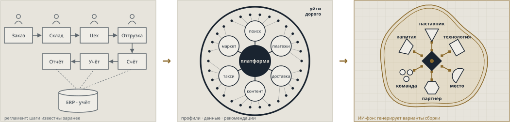

# th15 · Три волны информационных систем

> **Информационные системы обслуживают несущий ресурс своего уклада — сменился ресурс, сменилась и
> форма систем: регламент, экосистема, конфигурация.**
>
> **Слайды:** [`slides.html`](slides.html) — чистый тезис для показа и PDF.
> **Карточка:** [`index.html`](index.html) — слайды с подсветкой проверок, комментарии, вопросы, задания.

Рамка для разговора об ИС в лекции «Постинформационный переход»: три волны систем — автоматизация,
экосистемы, конфигурация — что в каждой считается единицей, связью, подстройкой и барьером и какие системы,
компании и бренды стоят на каждой волне. Классы систем по годам разобраны в следующем тезисе — [`th16`](../th16-is-classes-evolution/README.md).

## Слайд 1. Считать → говорить → собирать

> Квадраты регламента → круги экосистемы → штучная сборка вокруг одного ресурса.

<!-- notes -->

Читайте три схемы как три геометрии. **Первая волна** — цепочка прямоугольников: заказ → склад → цех →
отгрузка → счёт → учёт → отчёт, всё сходится в ERP. Шаги известны заранее, система их считает.
**Вторая волна** — хаб и спицы: в центре платформа, вокруг сервисы (поиск, платежи, доставка, контент,
такси, маркет), по краю — пользователи с профилями. Толстый обод — «уйти дорого». **Третья волна** —
неправильный контур вокруг одного уникального ресурса (◆), к которому пристыкованы наставник,
технология, место, партнёр, команда, капитал. Каждая стыковка — ставка с двух сторон (▪—▪), двойной
контур — вход через обязательство, а ИИ на фоне генерирует варианты сборки.

Главный ход тезиса: форма систем — не мода и не прогресс «железа», а следствие того, какой ресурс несёт
уклад. Пока ресурс — операция, систему строят по регламенту; когда ресурс — внимание и данные
пользователя, — вокруг платформы; когда ресурс уникален и не воспроизводится, систему собирают под него.

## Слайд 2. Единица, связь, подстройка, барьер
<!-- layout: columns -->

| Автоматизация бизнес-процессов · волна 1, 1950–1990-е | Экосистемы, цифровизация · волна 2, 1990–2020-е | Конфигурация · волна 3, с 2020-х |
|---|---|---|
| *Системы считают* | *Системы говорят и связывают* | *Системы собирают* |
| **Единица:** операция в регламенте | **Единица:** сервис и профиль пользователя | **Единица:** уникальный ресурс — место, тело, круг |
| **Связь:** стрелка потока, всё в учёте | **Связь:** хаб и спицы через платформу | **Связь:** обоюдная ставка |
| **Подстройка:** человек под процесс | **Подстройка:** продукт под сегмент | **Подстройка:** каждая деталь — под ресурс |
| **Барьер:** на входе — внедрить дорого | **Барьер:** на выходе — уйти дорого | **Барьер:** невоспроизводимость — скопировать нельзя |

<!-- notes -->

Слайд читается по строкам, а не по колонкам — так видно, что меняется не один признак, а вся
конструкция. Самая сильная строка — **барьер**: в первой волне дорого войти (внедрение ERP — годы и
бюджеты), во второй дорого выйти (профиль, история, связи остаются в экосистеме), в третьей копировать
нечего — ценность в невоспроизводимом ресурсе и в ставках, которые на него сделаны.

Строка **подстройки** показывает, кто под кого меняется: человек под процесс → продукт под сегмент →
всё под ресурс. Это та же логика, что «прогресс → тренды → инверты» (`c05`): третья волна проектирует
конфигурацию будущего окружения, а не улучшает процесс и не ловит тренд.

Глаголы «считать → говорить → собирать» — короткая форма тезиса, её стоит дать студентам записать.

## Слайд 3. Кто на какой волне
<!-- layout: columns -->

| Автоматизация · волна 1 | Экосистемы · волна 2 | Конфигурация · волна 3 |
|---|---|---|
| **Классы:** учёт и АСУ, базы данных, ERP, САПР, BI, ГИС | **Классы:** веб и поиск, соцсети, мессенджеры, облака, платформы, маркетплейсы | **Классы:** заверение и незапись, семантические ИИ-движки, социальные двойники, машины сборки |
| **Системы:** LEO, SABRE, ОГАС, Oracle, Excel, AutoCAD, SAP R/3, 1С:Предприятие | **Системы:** Google, ВКонтакте, WhatsApp, WeChat, AWS, Salesforce, Uber, Авито, ChatGPT | **Системы:** C2PA, Signal, local-first, RAG, MCP, ИИ-агенты, Generative Agents |
| **Компании и бренды:** IBM, SAP, Oracle, Microsoft, Autodesk, 1С, АСКОН, «Галактика» | **Компании и бренды:** Google, Meta, Amazon, Tencent, Яндекс, Сбер, VK, Ozon, Wildberries | **Компании и бренды:** Signal, Autodesk (Fusion), Materialise |
| | **В разборах базы:** <mark>Сбер (`th04`), Wildberries (`th05`)</mark> | **В разборах базы:** <mark>Loro Piana (`th06`), Como 1907 (`th02`)</mark> |

Примеры систем и брендов — с ленты классов [`th16`](../th16-is-classes-evolution/README.md).

<!-- notes -->

Первые три строки — информационные системы и их производители; годы и пики классов — на ленте
[`th16`](../th16-is-classes-evolution/README.md). Одна и та же компания может стоять в двух волнах:
Яндекс начинался с поиска — системы, описывающей сеть (логика первой волны), и вырос в экосистему
«всего»; Autodesk — САПР первой волны и машина сборки третьей (Fusion). Волну задаёт логика системы,
а не бренд.

Последняя строка — не ИС, а модели бизнеса из базы тезисов, прочитанные через ту же рамку. Сбер и
Wildberries — экосистемы: хаб, сервисы вокруг профиля, барьер на выходе. Loro Piana и Como 1907 —
сборка вокруг уникального ресурса: сверхредкое природное сырьё и место (город и озеро Комо), к которым
пристыкованы бренд, контент, туризм, капитал. Это предложение для обсуждения, а не установленная
классификация.

У третьей волны пока мало компаний-брендов: классы только складываются, и место для своих ставок —
у студентов и партнёров мастерской.

## Вопросы

1. Какой несущий ресурс у каждого уклада и почему от него зависит форма информационной системы?
2. Почему барьер «переезжает» с входа на выход, а потом исчезает как барьер доступа и становится
   невоспроизводимостью? Приведите пример компании для каждой волны.
3. Где на ваших примерах проходит граница между экосистемой (волна 2) и конфигурацией (волна 3)?
   Может ли экосистема собирать конфигурации?
4. Что в третьей волне делает ИИ, если «генерирует варианты сборки», а не считает и не рекомендует?
5. Чем «обоюдная ставка» отличается от договора и от подписки?

## Задания

| Задание | Что сделать |
|---|---|
| Три волны одной отрасли | Взять отрасль (страхование, ритейл, спорт) и описать систему каждой волны по четырём строкам слайда 2 — с примерами компаний и источниками |
| Конфигурация на стенде | Для одного стенда мастерской назвать уникальный ресурс, пристыкованные к нему элементы и ставки с обеих сторон — нарисовать схему в языке слайда 1 |
| Волны Тоффлера и волны ИС | В докладе [`tpl16`](../../assignments/templates/tpl16-toffler-waves.md) сопоставить волны Тоффлера с тремя волнами ИС: где границы совпадают, где нет |

### Что проверить

Тезис — авторская рамка: цифры в нём — только границы волн, и это периодизация, а не данные. Слайды
перенесены из авторских материалов лекции без изменения смысла.

| Утверждение | Слайд | Статус | Что уточнить |
|---|---|---|---|
| Границы волн: 1950–1990-е, 1990–2020-е, с 2020-х | 1–2 | авторская периодизация | Согласовать с лентой классов в [`th16`](../th16-is-classes-evolution/README.md), где волна 1 заканчивается в середине 1990-х |
| Примеры сервисов второй волны (поиск, платежи, доставка…) | 1 | иллюстрация | Не данные; при разборе компании заменить реальным набором сервисов с источником |
| Разборы базы по волнам: Сбер и Wildberries — волна 2, Loro Piana и Como 1907 — волна 3 | 3 | предложение ассистента | Подтвердить у автора рамки: в исходных слайдах этой привязки нет |
| Системы, компании и бренды волн 1–3 | 3 | с ленты [`th16`](../th16-is-classes-evolution/README.md) | Добавлены SAP R/3, 1С:Предприятие, Tencent, АСКОН как разработчик КОМПАС-3D — сверить по сайтам компаний |

## Связи

- **Опирается на:** методологию постинформационного перехода (`m01`), «Прогресс · Тренды · Инверты»
  (`c05`), различение автоматизации, цифровизации и трансформации (`m07`) —
  [каталог дисциплины](../../disciplines/technologies-econ-fin/catalog/README.md).
- **Объекты каталога:** экосистема экосистем (`c18`) — предельная форма второй волны.
- **Примеры в базе:** Сбер [`th04`](../th04-sber-model/README.md), Wildberries [`th05`](../th05-wildberries-model/README.md),
  Loro Piana [`th06`](../th06-loro-piana-model/README.md), Como 1907 [`th02`](../th02-como-1907-model/README.md).
- **Дальше:** классы систем по годам — [`th16`](../th16-is-classes-evolution/README.md).
- **Входит в сборки:** пока ни в одну; кандидат — лекция «Постинформационный переход».

## Источники

- Авторские слайды лекции «Три волны информационных систем» (слайд 01), курс «Технологии (ИСЭиФ)»,
  блок «Постинформационный переход». Файл `tri_volny_IS_slide01.html`, передан автором 2026-10-16.

Тезис собран с помощью ИИ-ассистента по слайдам лекции и требует ревью автора
([`rules/ai-usage.md`](../../rules/ai-usage.md)).
