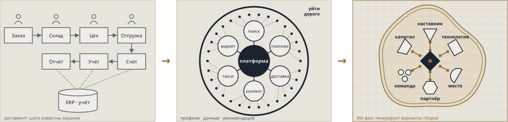

# th15 · Три волны информационных систем

> **Автоматизация передаёт процессы машинам, цифровизация переводит решения на данные, программирование рынков схлопывает
> процессы в конфигурации — ценность смещается от эффективности процессов к эффективности решений и
> к созданию рынков и архитектур.**
>
> **Слайды:** [`slides.html`](slides.html) — чистый тезис для показа и PDF.
> **Карточка:** [`index.html`](index.html) — слайды с подсветкой проверок, комментарии, вопросы, задания.

Рамка для разговора об ИС в лекции «Постинформационный переход»: три шага развития — автоматизация,
цифровизация, программирование рынков. Для каждого шага — суть, ценность и технологии, что в нём считается
единицей, связью, подстройкой и барьером, и какие системы, компании и бренды стоят на каждом шаге.
Классы систем по годам разобраны в следующем тезисе — [`th16`](../th16-is-classes-evolution/README.md).

## Слайд 1. Процессы → решения → конфигурации

> Автоматизация исполняет процесс, цифровизация помогает решать на данных, программирование рынков собирает конфигурацию.

<!-- notes -->

Читайте три схемы как три геометрии. **Автоматизация** — цепочка прямоугольников: заказ → склад → цех →
отгрузка → счёт → учёт → отчёт, всё сходится в ERP. Шаги известны заранее, их исполняют роботы,
автоматы и информационные системы. **Цифровизация** — хаб и спицы: в центре платформа с данными, вокруг
сервисы (поиск, платежи, доставка, контент, такси, маркет), по краю — пользователи с профилями. Решения
принимаются на данных: рекомендации, скоринг, аналитика. Толстый обод — «уйти дорого». **Программирование
рынков** — неправильный контур вокруг одного уникального ресурса (◆), к которому пристыкованы
наставник, технология, место, партнёр, команда, капитал. Цепочки процессов схлопываются: то, что было
десятком шагов и систем, делается в одном контексте. Каждая стыковка — ставка с двух сторон (▪—▪),
двойной контур — вход через обязательство, а ИИ на фоне генерирует варианты сборки и держит контекст.

Главный ход тезиса: меняется не только техника, а то, **за что платят**. Автоматизация повышает
эффективность бизнес-процессов, цифровизация — эффективность решений, программирование рынков создаёт новые рынки и
архитектуры — конфигурации, которых раньше не было.

## Слайд 2. Суть, ценность, технологии, барьер
<!-- layout: columns -->

| Автоматизация · волна 1, 1950–1990-е | Цифровизация · волна 2, 1990–2020-е | Программирование рынков · волна 3, с 2020-х |
|---|---|---|
| **Суть:** передача процессов роботам, автоматам, информационным системам | **Суть:** работа с данными и на основе данных | **Суть:** схлопывание процессов, конфигурации, управление контекстом, коллективным сознанием и эволюцией популяций |
| **Ценность:** эффективность бизнес-процессов | **Ценность:** эффективность принятия решений | **Ценность:** создание рынков и архитектур |
| **Технологии:** ERP, офисные пакеты, САПР, АСУ ТП, СЭД, роботы и станки с ЧПУ | **Технологии:** BI, ML, deep learning, data science, большие данные, облака, IoT, платформы, экосистемы, ГИС | **Технологии:** ИИ, AI native, LLM, ИИ-агенты, управление контекстом (RAG, MCP), генеративный дизайн, фиджитал |
| **Инфраструктура:** развитие ИТ-инфраструктуры организаций | **Инфраструктура:** распределённая инфраструктура, ЦОДы, рост вычислений | **Инфраструктура:** суперЦОДы и видеокарты, энергия как критический ресурс |
| **Единица:** операция в регламенте | **Единица:** сервис и профиль пользователя | **Единица:** уникальный ресурс |
| **Связь:** стрелка потока, всё в учёте | **Связь:** хаб и спицы через платформу | **Связь:** обоюдная ставка |
| **Подстройка:** человек под процесс | **Подстройка:** продукт под сегмент | **Подстройка:** каждая деталь — под ресурс |
| **Барьер:** на входе — внедрить дорого | **Барьер:** на выходе — уйти дорого | **Барьер:** невоспроизводимость |

<!-- notes -->

Это главный слайд тезиса — его стоит дать студентам записать. Читайте по строкам. **Суть:** сначала
машина делает то, что делал человек, по тому же регламенту; потом данные, которые оставляют процессы
и пользователи, становятся основой решений; наконец ИИ-системы перестают обслуживать цепочку и собирает
результат сразу — из контекста, а не из последовательности шагов.

На третьем шаге объект управления укрупняется: не процесс и не решение, а **рынок** (его правила,
участники и стимулы задаются как программа), **коллективное сознание** (общая картина мира, которую
разделяют люди и агенты) и **эволюция популяций** (компаний, продуктов, сообществ, которые
отбираются и размножаются в заданной среде). Это и есть «создание рынков и архитектур» в строке
ценности.

**Ценность** — самая важная строка. Автоматизация и цифровизация улучшают существующий бизнес:
быстрее, дешевле, точнее. Третий шаг меняет вопрос: не «как сделать процесс эффективнее», а «какой рынок и
какая архитектура теперь возможны». Это та же логика, что «прогресс → тренды → инверты» (`c05`).

**Технологии** — ориентиры, а не исчерпывающий список. Граница проходит по логике использования, а не по
дате появления: нейросети существуют с середины XX века, но на третий шаг их переводит работа с контекстом и
сборка конфигураций, а не классификация на данных. **Фиджитал** — соединение физического и цифрового
(спорт, ритейл, места), где ИИ собирает опыт вокруг конкретного места или тела.

**Инфраструктура** показывает, на чём держится каждый шаг. Автоматизация — это собственная
ИТ-инфраструктура организации: серверы, сети, рабочие места. Цифровизация уносит вычисления в
распределённую инфраструктуру и ЦОДы, объём вычислений растёт вместе с данными. Программирование
рынков упирается в суперЦОДы и видеокарты для обучения и работы моделей, и критическим ресурсом
становится энергия: кто имеет доступ к мощности и электричеству, тот может собирать рынки.

Слайд показывает, что меняется не один признак, а вся конструкция. Самая сильная строка — **барьер**:
при автоматизации дорого войти (внедрение ERP — годы и бюджеты), при цифровизации дорого выйти
(профиль, история, данные остаются в экосистеме), при программировании рынков копировать нечего — ценность в
невоспроизводимом ресурсе (место, тело, круг) и в ставках, которые на него сделаны.

Строка **подстройки** показывает, кто под кого меняется: человек под процесс → продукт под сегмент →
всё под ресурс. Третий шаг проектирует конфигурацию будущего окружения, а не улучшает процесс и не
ловит тренд.

## Слайд 3. Кто на какой волне
<!-- layout: columns -->

| Автоматизация · волна 1 | Цифровизация · волна 2 | Программирование рынков · волна 3 |
|---|---|---|
| **Классы:** учёт и АСУ, базы данных, офисные пакеты, ERP, САПР | **Классы:** BI и аналитика, ГИС, веб и поиск, соцсети, облака, платформы, маркетплейсы, ML-сервисы | **Классы:** LLM и ИИ-агенты, управление контекстом, онтологические платформы, фиджитал, заверение и незапись, социальные двойники, машины сборки |
| **Системы:** LEO, SABRE, ОГАС, Oracle, Excel, AutoCAD, SAP R/3, 1С:Предприятие | **Системы:** Google, ВКонтакте, Power BI, ArcGIS, 2ГИС, AWS, Salesforce, Uber, Авито | **Системы:** ChatGPT, Claude, Palantir AIP и Foundry, MCP, RAG, ИИ-агенты, Generative Agents, C2PA, Signal, local-first |
| **Компании и бренды:** IBM, SAP, Oracle, Microsoft, Autodesk, 1С, АСКОН, «Галактика» | **Компании и бренды:** Google, Meta, Amazon, Tencent, Esri, Яндекс, Сбер, VK, Ozon, Wildberries | **Компании и бренды:** OpenAI, Anthropic, Palantir, Signal, Autodesk (Fusion), Materialise |
| | **В разборах базы:** <mark>Сбер (`th04`), Wildberries (`th05`)</mark> | **В разборах базы:** <mark>OpenAI (`th03`), Loro Piana (`th06`), Como 1907 (`th02`)</mark> |

Примеры систем и брендов — с ленты классов [`th16`](../th16-is-classes-evolution/README.md).

<!-- notes -->

Первые три строки — информационные системы и их производители; годы и пики классов — на ленте
[`th16`](../th16-is-classes-evolution/README.md). Одна и та же компания может стоять на двух шагах:
Яндекс начинался с поиска и вырос в экосистему «всего», а сейчас строит свои LLM; Autodesk — САПР
автоматизации и машина сборки третьего шага (Fusion). Шаг задаёт логика системы, а не бренд.

BI и ГИС здесь стоят на шаге цифровизации — по логике «решения на данных». На ленте `th16` они отнесены
к первой волне по логике «система описывает мир». Это развилка для обсуждения: одна и та же система
может работать и как учёт, и как основа решений.

Последняя строка — не ИС, а модели бизнеса из базы тезисов, прочитанные через ту же рамку. Сбер и
Wildberries — экосистемы: хаб, сервисы вокруг профиля, барьер на выходе. OpenAI — производитель
технологии третьего шага. Palantir показывает тот же переход внутри одной компании: начинала с
аналитики данных для госзаказчиков (логика цифровизации), а платформа AIP с онтологией организации —
уже управление контекстом, на котором работают ИИ-агенты. Loro Piana и Como 1907 — сборка вокруг уникального ресурса: сверхредкое
природное сырьё и место (город и озеро Комо), к которым пристыкованы бренд, контент, туризм, капитал.
Это предложение для обсуждения, а не установленная классификация.

У третьего шага пока мало компаний-брендов: классы только складываются, и место для своих ставок —
у студентов и партнёров мастерской.

## Вопросы

1. Чем автоматизация отличается от цифровизации, если обе используют информационные системы? Где
   кончается «исполнять процесс» и начинается «решать на данных»?
2. Почему ценность смещается от эффективности процессов к эффективности решений, а затем к созданию
   рынков и архитектур? Приведите пример компании для каждого шага.
3. Что значит «схлопывание процессов»? Возьмите знакомый процесс (страховой случай, покупка билета) и
   покажите, какие шаги исчезают, если его делает ИИ-агент с доступом к контексту.
4. Почему барьер «переезжает» с входа на выход, а потом становится невоспроизводимостью?
5. Где на ваших примерах проходит граница между экосистемой (шаг 2) и конфигурацией (шаг 3)? Может ли
   экосистема собирать конфигурации?

## Задания

| Задание | Что сделать |
|---|---|
| Три шага одной отрасли | Взять отрасль (страхование, ритейл, спорт) и описать систему каждого шага по строкам слайда 2 — суть, ценность, технологии, барьер — с примерами компаний и источниками |
| Схлопывание процесса | Описать один бизнес-процесс партнёра мастерской как цепочку шагов автоматизации и показать, во что он схлопывается на шаге программирования рынков: что остаётся, что исчезает, какой нужен контекст |
| Конфигурация на стенде | Для одного стенда мастерской назвать уникальный ресурс, пристыкованные к нему элементы и ставки с обеих сторон — нарисовать схему в языке слайда 1 |
| Волны Тоффлера и волны ИС | В докладе [`tpl16`](../../assignments/templates/tpl16-toffler-waves.md) сопоставить волны Тоффлера с тремя шагами ИС: где границы совпадают, где нет |

### Что проверить

Тезис — авторская рамка: цифры в нём — только границы волн, и это периодизация, а не данные.
Суть, ценность, технологии и инфраструктура шагов (слайд 2) и название третьего шага даны автором 2026-11-11.

| Утверждение | Слайд | Статус | Что уточнить |
|---|---|---|---|
| Границы волн: 1950–1990-е, 1990–2020-е, с 2020-х | 2 | авторская периодизация | Согласовать с лентой классов в [`th16`](../th16-is-classes-evolution/README.md), где волна 1 заканчивается в середине 1990-х |
| Инфраструктура шагов: ИТ-инфраструктура организаций → распределённая инфраструктура и ЦОДы → суперЦОДы, видеокарты, энергия | 2 | авторская рамка (2026-11-11) | Для тезиса об энергии как критическом ресурсе подобрать данные: потребление ЦОДов (МЭА), капзатраты на ИИ-инфраструктуру — с источником и датой |
| BI и ГИС — шаг цифровизации | 2, 3 | авторская рамка (2026-11-11) | В [`th16`](../th16-is-classes-evolution/README.md) они отнесены к первой волне — согласовать или оставить как развилку |
| Технологии сверх авторского списка: САПР, АСУ ТП, СЭД, роботы и ЧПУ; большие данные, облака, IoT; ИИ-агенты, RAG и MCP, генеративный дизайн | 2 | дополнение ассистента | Подтвердить у автора рамки |
| Примеры сервисов второй волны (поиск, платежи, доставка…) | 1 | иллюстрация | Не данные; при разборе компании заменить реальным набором сервисов с источником |
| Программирование рынков, управление коллективным сознанием и эволюцией популяций — суть третьего шага, он же назван программированием рынков | 2 | авторская рамка (2026-11-11) | Раскрыть каждое понятие примером в заметках или отдельном тезисе |
| Palantir — шаг программирования рынков (AIP, Foundry, онтология) | 3 | авторская рамка (2026-11-11) | Сверить описание продуктов по сайту и годовому отчёту Palantir |
| Разборы базы по шагам: Сбер и Wildberries — шаг 2, OpenAI, Loro Piana и Como 1907 — шаг 3 | 3 | предложение ассистента | Подтвердить у автора рамки |
| Системы, компании и бренды шагов 1–3 | 3 | с ленты [`th16`](../th16-is-classes-evolution/README.md) и дополнения ассистента | Добавлены SAP R/3, 1С:Предприятие, Tencent, АСКОН, Esri, Power BI, ChatGPT, Claude, OpenAI, Anthropic, Palantir — сверить по сайтам компаний |

## Связи

- **Опирается на:** методологию постинформационного перехода (`m01`), «Прогресс · Тренды · Инверты»
  (`c05`), различение автоматизации, цифровизации и трансформации (`m07`) —
  [каталог дисциплины](../../disciplines/technologies-econ-fin/catalog/README.md).
- **Объекты каталога:** экосистема экосистем (`c18`) — предельная форма цифровизации.
- **Примеры в базе:** Сбер [`th04`](../th04-sber-model/README.md), Wildberries [`th05`](../th05-wildberries-model/README.md),
  OpenAI [`th03`](../th03-openai-model/README.md), Loro Piana [`th06`](../th06-loro-piana-model/README.md),
  Como 1907 [`th02`](../th02-como-1907-model/README.md).
- **Дальше:** классы систем по годам — [`th16`](../th16-is-classes-evolution/README.md).
- **Входит в сборки:** лекция [«Три волны информационных систем и цифровые деньги»](../assemblies/lec-is-waves-digital-money.md)
  (econ-3, 15.10.2026).

## Источники

- Авторские слайды лекции «Три волны информационных систем» (слайд 01), курс «Технологии (ИСЭиФ)»,
  блок «Постинформационный переход». Файл `tri_volny_IS_slide01.html`, передан автором 2026-10-16.
- Суть, ценность и технологии шагов развития — формулировки автора рамки, переданы 2026-11-11.

Тезис собран с помощью ИИ-ассистента по слайдам лекции и требует ревью автора
([`rules/ai-usage.md`](../../rules/ai-usage.md)).
