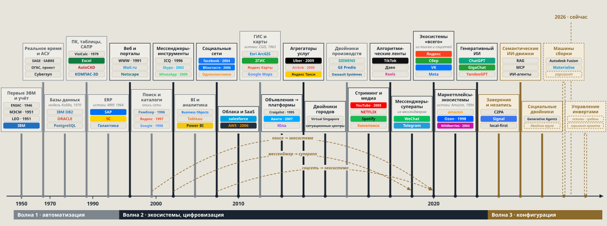

# th16 · Эволюция классов информационных систем

> **Классы информационных систем рождаются инструментами и дорастают до экосистем, а системы третьей
> волны — те, что собирают, — только формируются.**
>
> **Слайды:** [`slides.html`](slides.html) — чистый тезис для показа и PDF.
> **Карточка:** [`index.html`](index.html) — слайды с подсветкой проверок, комментарии, вопросы, задания.

Лента классов ИС от первых ЭВМ до экосистем «всего», социальных двойников и управления инвертами,
разложенная по трём волнам из рамки [`th15`](../th15-three-waves-is/README.md). Используется в лекции
«Постинформационный переход» сразу после рамки.

## Слайд 1. От первых ЭВМ до управления инвертами

Столбик стоит на пике класса — когда он стал массовым и задавал правила рынка; в метках — год
появления компании. Цвет — логика системы, а не дата. Пунктир — формирующийся класс, горизонт проекта.
Шкала неравномерная.

<!-- notes -->

Лента читается слева направо, но цвет важнее положения. Серые классы считают и описывают мир: учёт,
АСУ, базы данных, таблицы и САПР, ERP — но также поиск, BI, ГИС и двойники производств, хотя их пик
пришёлся на годы второй волны. Тёмные — говорят и связывают: веб, мессенджеры, соцсети, облака,
платформы объявлений, агрегаторы, стриминг, ленты, суперприложения, экосистемы «всего»,
маркетплейсы — и генеративный ИИ в его нынешнем виде. Латунные — собирают: заверение и незапись,
семантические ИИ-движки, социальные двойники; машины сборки и управление инвертами — пунктиром, это
горизонт проекта, а не рынок.

Марки на ленте набраны шрифтом в фирменных цветах, это не оригинальные логотипы.

## Слайд 2. Классы систем по волнам
<!-- layout: columns -->

| Считать, описывать · волна 1 | Говорить и связывать · волна 2 | Собирать · волна 3 |
|---|---|---|
| **Первые ЭВМ и учёт:** ENIAC, МЭСМ, LEO | **Веб и порталы:** WWW, Mail.ru | **Заверение и незапись:** C2PA, Signal, local-first |
| **АСУ:** SAGE, SABRE, ОГАС, Cybersyn | **Мессенджеры:** ICQ, Skype, WhatsApp | **Семантические ИИ-движки:** RAG, MCP, агенты |
| **Базы данных:** DB2, Oracle, PostgreSQL | **Соцсети:** Facebook, ВКонтакте | **Социальные двойники:** Generative Agents |
| **ПК и САПР:** VisiCalc, Excel, AutoCAD | **Облака и SaaS:** Salesforce, AWS | **Машины сборки** (формируется) |
| **ERP:** SAP, 1С, «Галактика» | **Платформы и агрегаторы:** Авито, Uber, Airbnb | **Управление инвертами** (горизонт) |
| **Поиск:** Рамблер, Яндекс, Google | **Стриминг и ленты:** YouTube, Netflix, TikTok | |
| **BI:** Business Objects, Tableau, Power BI | **Двойники городов:** Virtual Singapore | |
| **ГИС:** ArcGIS, 2ГИС, Google Maps | **Экосистемы:** Яндекс, Сбер, WeChat, Wildberries | |
| **Двойники производств:** Siemens, GE Predix | **Генеративный ИИ:** ChatGPT, GigaChat | |

Годы — на ленте слайда 1.

<!-- notes -->

Это та же лента, что на слайде 1, но сгруппированная по логике, а не по времени. Обратите внимание на
две неочевидные вещи. Первая: **поиск, ГИС, BI и двойники производств** — первая волна, хотя
расцвели позже 2000 года: они описывают мир (опись сети, карта, отчёт, модель цеха), а не связывают
людей. Вторая: **генеративный ИИ** стоит во второй волне — пока он работает как сервис экосистемы,
который говорит с пользователем. Третья волна начинается там, где ИИ встраивается в сборку: семантические
движки (RAG, MCP, агенты), социальные двойники, машины сборки.

Третья колонка короче не случайно: это классы, которые только складываются. Здесь у студентов и
партнёров мастерской больше всего места для своих ставок.

## Слайд 3. Инструмент дорастает до экосистемы

| Класс-инструмент | Во что переродился | Примеры |
|---|---|---|
| Поиск и каталоги | Экосистема «всего» | Яндекс |
| Социальная сеть | Экосистема «всего» | VK, Meta |
| Мессенджер-инструмент | Суперприложение | WeChat, Telegram |
| Доска объявлений | Платформа | Авито, Юла |
| Агрегатор услуг | Платформа | Uber, Яндекс Такси |

> Многие классы рождаются инструментами и доформировываются в экосистемы позже: логика класса
> меняется, а имя компании остаётся.

<!-- notes -->

На ленте слайда 1 эти перерождения показаны пунктирными дугами от инструмента к экосистеме:
поиск → экосистема, мессенджер → суперприложение, соцсеть → экосистема. Поэтому одна и та же компания
может стоять в двух местах ленты: Яндекс — в поиске 1997 года и в экосистемах «всего».

Вопрос для обсуждения: произойдёт ли то же с классами третьей волны — и во что они могут
переродиться? Если экосистема держит пользователя барьером на выходе, то конфигурация не держит
никого: её нельзя скопировать (см. [`th15`](../th15-three-waves-is/README.md), слайд 2).

## Вопросы

1. Почему поиск и ГИС отнесены к логике первой волны, хотя их пик пришёлся на 2000–2010-е?
2. Почему генеративный ИИ на ленте — вторая волна, а семантические ИИ-движки — третья? Что должно
   измениться в ИИ-сервисе, чтобы он перешёл в третью волну?
3. Какие классы первой волны так и не переродились в экосистемы и почему (ERP, САПР, BI)?
4. Возьмите российскую экосистему (Яндекс, Сбер, VK) и проследите, из какого класса-инструмента она
   выросла и через какие шаги.
5. Какой класс третьей волны вы готовы проверить ставкой на стенде мастерской?

## Задания

| Задание | Что сделать |
|---|---|
| Сверка ленты | Проверить годы на ленте слайда 1 по первоисточникам (сайты и отчётность компаний, история продукта) и внести источник к каждой дате |
| Ещё один класс | Найти класс ИС, которого нет на ленте (например, CRM, онлайн-банкинг, госуслуги), определить его волну по логике, а не по дате, и обосновать |
| Перерождение | Для одной компании-инструмента описать путь до экосистемы: годы, сервисы, сделки — с источниками |

### Что проверить

Лента перенесена со слайда лекции; годы при переносе по первоисточникам не сверялись. Расположение
столбиков («пик класса») — авторская оценка, а не данные.

| Утверждение | Слайд | Статус | Что уточнить |
|---|---|---|---|
| МЭСМ — 1951 | 1 | неоднозначно | Пробный пуск — 1950, приёмка в эксплуатацию — 1951: выбрать событие и указать источник |
| AWS — 2006 | 1 | неоднозначно | Платформа Amazon Web Services — 2002, запуск S3 и EC2 — 2006: указать, что именно датировано |
| Годы появления компаний и продуктов | 1 | не проверено | Сверить по сайтам и отчётности компаний, к каждой дате — источник |
| Пик класса и границы волн на ленте | 1 | авторская оценка | Критерий «стал массовым и задавал правила рынка» — чем измеряется; согласовать с границами в [`th15`](../th15-three-waves-is/README.md) |
| Generative Agents | 2 | не проверено | Ссылка на исследование (Park et al., Stanford и Google, 2023) |

## Связи

- **Опирается на:** рамку трёх волн — [`th15`](../th15-three-waves-is/README.md); методологию
  постинформационного перехода (`m01`) и различение автоматизации и цифровизации (`m07`) —
  [каталог дисциплины](../../disciplines/technologies-econ-fin/catalog/README.md).
- **Объекты каталога:** экосистема экосистем (`c18`), данные и цифровые двойники (`tech-data`).
- **Рядом:** экосистемы в разборах — Сбер [`th04`](../th04-sber-model/README.md), Wildberries
  [`th05`](../th05-wildberries-model/README.md); рынок ИС в России — [`th07`](../th07-it-market-size-russia/README.md).
- **Входит в сборки:** лекция [«Три волны информационных систем и цифровые деньги»](../assemblies/lec-is-waves-digital-money.md)
  (econ-3, 15.10.2026).

## Источники

- Авторские слайды лекции «Эволюция классов систем» (слайд 02), курс «Технологии (ИСЭиФ)», блок
  «Постинформационный переход». Файл `tri_volny_IS_slide02.html`, передан автором 2026-10-16.

Тезис собран с помощью ИИ-ассистента по слайдам лекции и требует ревью автора
([`rules/ai-usage.md`](../../rules/ai-usage.md)).
